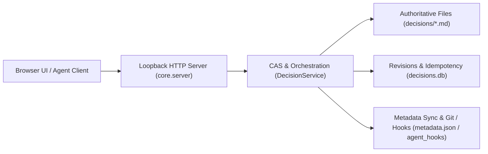

# Agent Decisions Dashboard

[简体中文](README.md) · [Live Docs](https://agent-decisions-dashboard.cbnv.me/en/) · [Docs Source](docs-site/en/index.md) · [Chinese Source Guide](repo-docs/README.md)

[](./LICENSE)
[](./pyproject.toml)
[](./pyproject.toml)
[](./tests/)

A local decision ledger and review workbench for human-agent engineering collaboration, built on the Python 3.9+ standard library, SQLite, and zero-build static assets.

## Capabilities & Explicit Boundaries

| Dimension | ✅ What It Can Do (Delivered) | ⛔ Explicit Non-Goals & Limits |
| --- | --- | --- |
| Runtime & Scope | Runs purely on Python 3.9+ stdlib + SQLite with zero CDN/build step; attaches external projects via `--config` | Loopback-only (rejects `0.0.0.0`), single-process lock; no remote auth or multi-user sharing of one DB |
| Ledger & Recovery | `schema_version: "2.0"` Markdown + SQLite `revisions`, CAS locks, `request_id` idempotency, hot backups & isolated Git commits | `metadata.json` cannot restore snapshots alone; never replaces build/CI pipelines |
| Agent Integration | `topic_scope`-filtered 5-bucket context export, read-only `agent_hooks` CLI, and `agent-question` radio cards | `accepted` / `verified` labels stay passive records and never run tests or grant shell execution |

## Core Capabilities & Data Flow

- **Orthogonal 3-axis state governance**: Decouples `workflow_state`, `decision_outcome` (including `partially_accepted`), and `implementation_state` while keeping legacy read compatibility.
- **Dual-pane review workbench**: Supports topic creation, round appends, latest-round amendment (`edit_latest_round`), safe archive deletion (`delete_topic`), and interactive `agent-question` option fences.
- **Traceable write pipeline**: Coordinates authoritative `schema_version: "2.0"` Markdown files with SQLite optimistic locking (`expected_version`), ABA monotonic guards, `request_id` idempotency, and optional path-isolated Git commits.
- **Read-only agent integration**: Provides `topic_scope`-filtered context buckets (`GET /api/agent/context`) and read-only CLI hooks (`before-task` / `after-write`) without side effects or test execution.



- **Local security boundaries**: Binds exclusively to loopback hosts, enforces `Host`, `Origin`, and `Sec-Fetch-Site` checks, caps request bodies at 10 MiB (10s read timeout), and blocks path traversal or Windows reserved IDs.

## Quick Start

Requires Python 3.9+. No Node.js, pnpm, or external CDN is needed to run the dashboard (`node` is only for `tests/*.test.js` and `pnpm` only for building `docs-site/`):

```sh
git clone https://github.com/CyberNova2333/agent-decisions-dashboard.git
cd agent-decisions-dashboard
./start_dashboard.sh --port 8765
# Or run directly: python3 -m core.server --port 8765
# Run headless on custom port: python3 -m core.server --port 8765 --no-browser
```

Open `http://127.0.0.1:8765/dashboard.html`; run the test suites via `python3 -m unittest discover tests && node --test tests/*.test.js`.

| Mode / Platform | Command | Documentation |
|---|---|---|
| Windows startup | Run or double-click `start_dashboard.bat` (forwards CLI flags) | [Setup & Configuration](docs-site/en/docs/index.md) |
| Attach external project | `python3 -m core.server --config /path/to/dashboard.config.json --no-browser` | [Config Matrix and Precedence](docs-site/en/docs/index.md#configuration-matrix-and-precedence) |
| Offline check & rebuild | `python3 -m core.server --check-consistency` / `--rebuild-index` | [Deployment Troubleshooting](docs-site/en/docs/index.md#deployment-troubleshooting-faq) |
| Export module context | `python3 -m core.server --export-agent-context 存储层` | [Context Export & Contracts](docs-site/en/docs/contracts.md) |
| Read-only agent hooks | `python3 -m core.agent_hooks --config dashboard.config.json before-task` | [Contracts & Extensions](docs-site/en/docs/contracts.md) |

## Pre-adoption FAQ

**Q: Do I need Node.js, npm, or internet access to run the dashboard?**

No. The backend uses only the Python standard library and SQLite, and Mermaid 12.1.0, Anime.js 4.5.0, and IBM Plex Sans are bundled under `web/vendor/`. Node is only required for frontend unit tests, and pnpm only for `docs-site/`.

**Q: Can multiple remote users or separate server processes share one ledger directory concurrently?**

No. The HTTP gateway accepts loopback hosts only and relies on an in-process `threading.RLock`; run at most one server process per `database_path`.

**Q: Will auto Git commits accidentally commit unrelated staged code changes?**

No. `core.git_engine` inspects the Git index before committing and skips with `git_status: "skipped_unrelated_staged"` if unrelated staged files exist, while keeping the ledger save intact.

**Q: Does marking `accepted`, `verified`, or choosing an `agent-question` option execute tests or code?**

No. Labels and selections are stored purely as ledger text and state; `core.agent_hooks` is strictly read-only and never runs project builds or tests.

**Q: Can `decisions/*.md` or `metadata.json` alone replace `decisions.db`?**

Markdown holds authoritative current content and `--rebuild-index` reconstructs `topics`, whereas `metadata.json` is a summary cache only and full `revisions` + `idempotency_keys` history lives in `decisions.db`.

## Reading Paths

| Goal | Docs Site Stage | Source Guide (`repo-docs/`) |
|---|---|---|
| Install, attach projects & configure scopes | [Setup & Configuration](docs-site/en/docs/index.md) | [Source Guide Overview (ZH)](repo-docs/README.md) |
| Browse endpoints, CLI flags & call examples | [API & Component Reference](docs-site/en/api-reference/index.md) | [Contracts & Extensions](docs-site/en/docs/contracts.md) |
| Integrate HTTP API, contracts & hooks | [Contracts & Extensions](docs-site/en/docs/contracts.md) | [States & Agent Workflow (ZH)](repo-docs/modules/states-and-agent-workflow.md) |
| Trace one write run, CAS & migrations | [Architecture & Code Guide](docs-site/en/docs/architecture.md) | [One Real Run Walkthrough (ZH)](repo-docs/walkthroughs/one-real-run.md) |
| Locate core modules, recovery & tests | [Code Map and Migrations](docs-site/en/docs/architecture.md#code-map-and-key-migrations) | [Code Map](repo-docs/code-map.md) · [Save & Recovery](repo-docs/modules/save-idempotency-and-recovery.md) |
| Audit evidence, glossary & contributor rules | [Design Spec (`DESIGN.md`)](DESIGN.md) · [Contributing](CONTRIBUTING.md) | [Glossary](repo-docs/glossary.md) · [Source Evidence](repo-docs/references/source-evidence.md) |

For repo questions and behavior-changing edits, follow the `repo-docs` Sync gate in [AGENTS.md](AGENTS.md) and update stale guide pages.

## License & Acknowledgements

Licensed under [AGPL-3.0-only](./LICENSE). Vendored frontend assets under `web/vendor/` preserve their upstream licenses: Mermaid 12.1.0 ([MIT](./web/vendor/mermaid-LICENSE)), Anime.js 4.5.0 ([MIT](./web/vendor/ANIMEJS-LICENSE.md)), and IBM Plex Sans ([OFL](./web/vendor/IBM-Plex-Sans-LICENSE.txt)).
