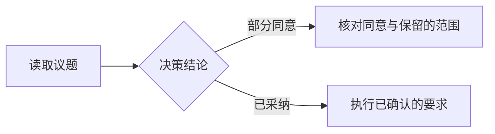
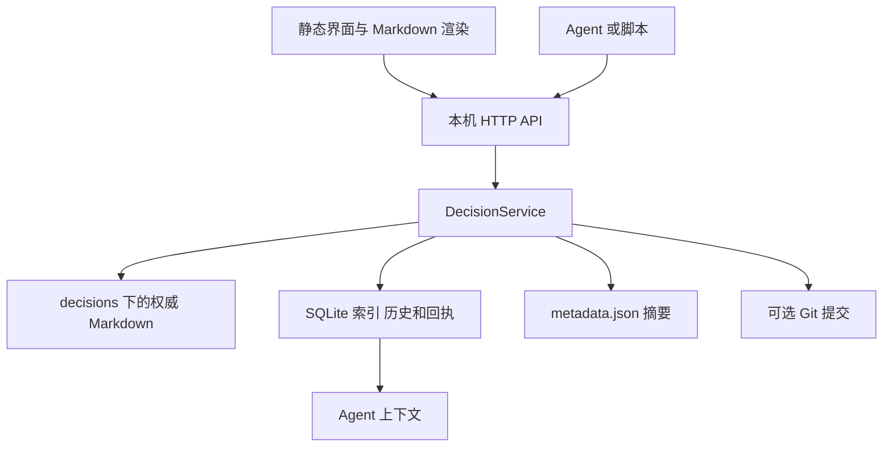

# Agent Decisions Dashboard ⚖️

[English](README.en.md) · [中文源码指南](repo-docs/README.md)

面向个人与本机 Agent 协作的决策台账：保留讨论原话、记录当前结论、跟踪实现状态，并通过版本历史追溯修改。

[](./LICENSE)
[](./pyproject.toml)

[](./tests/)

Python 服务仅使用标准库，界面是静态 HTML/CSS/JavaScript；Mermaid 图表库随项目提供，无需前端构建、npm 安装或运行时访问 CDN。项目按源码目录或 Python 包组织，不是单文件可执行程序。

适用范围是本机记录与追溯。不提供账号权限、多人远程协作、任务排期或自动执行 Agent；上下文需要调用者主动读取，导出文档不能保证 Agent 遵守结论。

## 当前功能

| 功能 | 当前行为 |
|---|---|
| 新建议题 | 填写 ID、标题、可选所属对象和正文；页面创建为“待决策／尚无结论／未开始” |
| 记录决策 | 追加多行用户意见和团队答复，分别设置工作流、决策结论与实现状态 |
| **部分同意** | 独立结论 `partially_accepted`；切换为此结论时需填写用户意见，说明同意和保留的范围；卡片、筛选和概览单独标示 |
| 推迟再议与替代 | 独立于是否同意；可记录“已同意，条件满足后再议”，保留已被替代议题的原结论与替代议题引用 |
| 修改本轮 | 修改最近一轮已提交回复，保留修改前的版本；不增加讨论轮数，更早轮次只读 |
| 查找与展开 | 按工作流、结论、实现状态和业务对象筛选；搜索 ID、标题、摘要、否决原因和最近有内容的答复；展开／收起当前筛选下的全部议题 |
| 阅卷视图 | 在保留顶部 banner 与左侧筛选栏的主工作区内逐题处理议题；左上显示大号序号／总数，中央只滚动“展开详情”后的核心论述与历史，右侧栏显示上一轮 Agent 回复（只读）、可修改的本轮用户意见，以及进展、结论和实现状态小按钮；议题总览、上一个、下一个、提交位于右侧栏底部，提交用户意见修改时沿用版本与幂等检查 |
| Agent 提供选项 | 最新一轮 Agent 回复可附带问题和单选答案；在阅卷侧栏选择后，仍可在“本轮用户意见”中补充多行文字，一次提交保存两者；也可只写文字 |
| 保存后定位 | 刷新状态和详情缓存，保持刚保存的议题展开并定位；若不再符合原筛选条件，会提示并清除筛选以显示目标 |
| Markdown 与图表 | 表格、多行文本、标题、列表、引用、代码围栏、安全链接和本地 Mermaid 渲染 |
| 历史与恢复 | 查看快照、恢复单议题、撤销创建或恢复全库快照；台账保存与 Git 提交分别反馈 |
| 外观 | 遵循系列 DESIGN.md 的蓝黑配色，默认深色，可切换浅色模式；主按钮使用浅色文字，Anime.js 本地加载并尊重减少动效设置 |
| Agent 与维护 | 完整上下文导出、可选只读检查钩子、实现证据登记、一致性检查、索引重建与 SQLite 在线备份 |

## 快速上手

### 环境与启动

- Python 3.9 及以上。下文使用 `python`；Linux/macOS 若命令名为 `python3`，相应替换。
- Git 仅自动提交功能需要；先准备仓库与提交身份，也可关闭该功能。
- 使用现代浏览器。Node 仅用于运行前端测试，不是启动看板的前提。

在本仓库根目录运行：

```sh
python -m core.server --port 8765
```

服务默认打开浏览器；访问 `http://127.0.0.1:8765/dashboard.html`，不希望自动打开时加 `--no-browser`。也可双击 Windows 的 [start_dashboard.bat](./start_dashboard.bat)，或在 Linux/macOS 运行 `bash start_dashboard.sh`。两个脚本均切换到源码目录，并透传命令行参数。

### 接入已有数据项目

在数据项目准备 `dashboard.config.json`，再从本仓库根目录启动：

```sh
python -m core.server --config "D:/MyProject/dashboard.config.json" --no-browser
```

相对数据路径和 Git 操作目录以配置文件所在目录为基准，无需把服务源码复制进数据项目。同一数据目录只运行一个服务实例；修改后端源码或配置后需要重启，界面代码更新后重新加载页面。重载前先保存或另行备份标签页中的草稿。

未指定 `--config` 时，读取当前工作目录的 `dashboard.config.json`；默认文件不存在则采用内置值。显式指定的文件不存在、JSON 无效或根节点不是对象时，启动会失败。

| 配置项 | 内置默认值与用途 |
|---|---|
| `project_name` / `project_subtitle` | 项目标题与副标题 |
| `brand_logo` / `brand_icon` | 顶栏文字标识与图标 |
| `host` / `port` | `127.0.0.1` / `8765`；命令行覆盖环境变量，环境变量覆盖文件配置 |
| `decisions_dir` | `decisions`，权威 Markdown 文件 |
| `database_path` | `decisions.db`，当前索引、历史快照与请求回执 |
| `metadata_json_path` | `decisions/metadata.json`，派生摘要 |
| `git_commit.enabled` | `true`；设为 `false` 时只保存台账，不自动提交 Git |
| `git_commit.commit_prefix` / `co_author` | 自动提交前缀 / 协作署名；署名默认留空 |
| `git_commit.include_user_opinion` / `include_agent_reply` | 默认均为 `true`，控制是否将本次原话／答复写入 Git 提交说明 |
| `categories.objects` | 业务对象筛选列表；`categories.functions` 保留分类配置，当前页面没有业务功能筛选器 |
| `lifecycle_states` | 三种工作流状态的展示文字与徽章；不能通过配置增加后端支持的状态枚举 |

环境变量为 `AGENT_DASHBOARD_HOST`、`AGENT_DASHBOARD_PORT`。旧配置项 `doc_data_json_path` 不作为当前保存或导入入口。完整默认配置见 [dashboard.config.json](./dashboard.config.json) 和 [core/config.py](./core/config.py)。

### 第一次使用

1. 点击“新建议题”，填写 ID 和标题，可附正文。ID 为 1–128 位英文字母、数字、下划线或连字符；拒绝 Windows 设备名及仅大小写不同的重复 ID。
2. 点击“展开详情”查看正文与历史，再点击“记录决策”追加原话和答复。页面要求填写变更说明，即使关闭 Git 自动提交也如此。
3. 分别选择工作流、决策结论和实现状态。例如只同意方案的一部分时，选择“部分同意”，并在用户意见中写清范围。
4. 最近一轮需要更正时点击“修改本轮”。检查预填内容后保存，旧文本保留在版本历史；更早的意见用新一轮追加更正。
5. 核对保存反馈。Git 关闭或提交失败不等于台账未保存；不要因此重复追加同一段讨论。

页面编辑器不提供已有议题标题、正文与分类的修改入口；这些字段可通过保存 API 修改，也可在备份后编辑权威 Markdown 并核对、重建索引。

### 回答 Agent 提供的选项

Agent 在最新一轮答复中使用 `agent-question` 代码围栏提供一个问题。进入“阅卷视图”后，右侧显示问题和选项；初始不替用户选择，点击已选项可取消。在下方“本轮用户意见”中继续补充说明，点击“提交”后将问题、所选答案和补充文字一并保存为用户意见。可以不选任何选项，只填写自己的回答。

````markdown
建议先明确保存范围。

```agent-question
{
  "question": "这轮先实现哪种保存方式？",
  "options": [
    {"label": "先保存到本地", "description": "先完成本机使用流程"},
    {"label": "先讨论同步需求", "description": "明确范围后再实施"}
  ]
}
```
````

每条最新 Agent 回复支持一个问题、2–8 个不同的选项。`options` 中也可直接写字符串；`description` 可省略。无效格式保留为原文，不生成交互控件。旧轮次及普通详情仍保留完整原始答复。选项草稿与文字草稿一样只保存在当前标签页，切换议题保留，重载页面前需先保存。

选择答案不会自动改变议题进展、决策结论或实现状态；这些字段仍需单独核对。提交后重新进入该题，可继续修改选择和补充文字，旧版本保留在历史中。Agent 的写入示例见 [Agent 操作指南](./docs/agent-workflow.md#向用户提供可选答案)。

## 工作流、决策结论与实现状态

这三组字段独立保存。选择“已决策”不自动表示“全部同意”，选择“已采纳”也不表示代码已经实现。`decision_status` 是补充展示文本，不是第四套状态机。

| 字段 | 支持的值 |
|---|---|
| `workflow_state` | `pending` 待决策、`discussing` 待讨论、`decided` 已决策、`deferred` 推迟再议、`superseded` 已被替代 |
| `implementation_state` | `not_started` 未开始、`in_progress` 进行中、`implemented` 已实现、`verified` 已核验 |

`decision_outcome` 的完整取值如下：

| 值 | 含义与填写要求 |
|---|---|
| `""` | 尚无结论；新议题应明确保留此值 |
| `accepted` | 采纳接受 |
| **`partially_accepted`** | **部分同意**；从其他结论切换过来时，必须同时提交非空用户意见，说明哪些同意、哪些保留 |
| `rejected` | 明确否决；必须有非空 `rejection_reason` |

部分同意示例：“同意先保留本地文件；云端同步暂不接受，待隐私方案明确后再讨论。”服务检查用户意见是否非空，不自动理解或校验这段话的范围。否决原因中也可写重新讨论的前提，但没有单独的前提字段或语义校验。

同意延期示例：Agent 建议“试点结束后再讨论”，用户认可此安排，记录为 `decision_outcome: "accepted"` + `workflow_state: "deferred"`，把试点结束这一前提写在原话中。不是立即实施的指令，也不是对未来具体方案的提前授权；同意范围以原话为准。进展可单独改回“待讨论／待决策／已决策”，不会清空同意结论或实现状态。没有自动日期提醒或条件判断。

“已被替代”同样属于进展，保留旧议题的同意／部分同意／否决供追溯，可在页面或 API 的 `superseded_by` 填替代议题 ID。它不等于旧方案曾被否决。

兼容旧记录：旧 `decision_outcome: "deferred" / "superseded"` 读取为对应进展，但不会推断为同意。原 Markdown 与历史快照不会因读取被改写，后续保存才转为独立字段。旧 API 请求仍接受这两个别名，改变进展并保留已有明确结论；新请求应使用上述独立字段。旧快照恢复后仍按同一兼容规则读取。

页面与 Agent 导出的分类用途不同：

| 入口 | 当前纳入规则 |
|---|---|
| 页面“已定结论” | 进展为 `decided` 或 `deferred`，结论为 `accepted`、`partially_accepted` 或 `rejected`；部分同意、否决和推迟再议分别标注 |
| 页面“待决策” | 工作流为 `pending`；不等于“所有尚未实现的议题” |
| Agent `active_decisions` | 进展为 `decided`，且结论明确为 `accepted`；尚无结论不算同意 |
| Agent `rejected_proposals` | 未暂缓、未被替代的明确否决议题，包括兼容的旧否决文字 |
| Agent `pending_requirements` | 未暂缓、未被替代的未定议题、部分同意，以及已采纳但尚未核验的议题；列入此表不表示获准实施 |
| Agent `deferred_topics` | 全部推迟再议议题，保留结论、正文和讨论；应先核对原话中的继续条件，不进入立即推进清单 |
| Agent `superseded_topics` | 已被替代议题及原结论、替代引用，仅供追溯，不继续作为当前要求或否决红线 |

部分同意的导出保留完整正文与讨论，并提示按原话区分同意范围；不会自动把一个议题拆成多个要求。`decided` 搭配空结论仍需确认，不会被页面或 Agent 当成已同意。

“已核验”是调用者登记的状态。核验接口接收提交引用、核验人及测试说明，但不检查提交是否存在，也不运行测试；页面直接选择该状态同样不产生实际测试证据。

## Markdown、链接与流程图

- 保留文本中的单次换行和空段落；解析保存时会将 CRLF 归一化为 LF、裁剪字段两端空白，不保证字节级原样保存。
- 支持表格及列对齐、标题、简单有序／无序列表、引用、行内代码、粗体、代码围栏与链接。不是完整 CommonMark/GFM 实现，不承诺嵌套列表、任务复选框、图片或任意 Markdown 插件。
- 原始 HTML 作为文本显示。外部链接仅接受 HTTP(S)，不执行 `javascript:` 等链接。
- 议题链接可写 `[存储选择](#adr-storage)`、`[存储选择](decisions/adr-storage.md)` 或 `../decisions/adr-storage.md` 形式的 Markdown 链接；点击后定位并展开目标，必要时清除筛选。文件链接中的片段不会定位正文小标题，仍跳到议题本身。

流程图使用 `mermaid` 代码围栏，例如：

````markdown

````

Mermaid 12.1.0 的本地资源只在图表进入可视区域后加载，使用严格模式并随明暗／主题色变化重新绘制。不执行图表配置指令，不加载图表中的外部图片、图标或 CSS URL；语法错误时显示原因和源码。当前限制为 50,000 字符、500 条边，不保证所有 Mermaid 扩展都可用。版本、来源、校验值与 MIT 许可见 [web/vendor/](./web/vendor/)。

## 刷新、草稿与离线行为

- “刷新”按钮重新读取列表并检查文件与索引是否一致；窗口重新获得焦点也会刷新列表。没有后台文件监听或定时自动导入。
- 从页面提交成功后，会刷新状态、使旧详情缓存失效，并展开定位刚保存的议题。与原筛选仍匹配时保留筛选；不匹配时提示并清除筛选。其他脚本通过 API 写入后，点击“刷新”或重新切回窗口查看。
- 直接改 Markdown 不会自动覆盖 SQLite 索引。“刷新”遇到不同步会提示，需先核对改动，再按维护流程重建。
- 编辑草稿、未确认请求与冲突信息只保存在当前标签页内存。关闭编辑弹窗可继续编辑草稿；**重载或关闭网页会丢失未提交草稿**。主题偏好保存在浏览器本地存储，与草稿不同。
- 初次加载连不上服务时显示标明“离线示例”的演示数据，禁止提交；它不是已保存数据的离线副本。已加载项目后刷新失败，会保留当前列表而不替换成示例。

## 数据、历史与维护

### 各文件的职责



每个 `decisions/<id>.md` 保存元数据、正文与当前历史轮次；SQLite 另存修改前的快照、变更日志和请求回执。最近一轮被更正后的旧文本保存在数据库历史中，不能仅靠当前 Markdown 还原。`metadata.json` 只有摘要，不能单独恢复项目。

数据库没有议题时，启动会尝试导入已有 Markdown；新项目默认空白，不会自动复制 [examples/decisions/](./examples/decisions/)。导入警告或部分成功需要进一步核对，不能只凭“服务已启动”认定一致。

单议题恢复会恢复该议题在指定快照中的状态，并生成新版本，其他议题保持不变。恢复到创建前可撤销创建；恢复已删除议题也受版本和重试契约保护。全库恢复影响全部议题，快照外的 Markdown 会归档，应明确区分这两种操作。

快照是可写 SQLite 中的记录，不具备防篡改签名保证。SQLite 在线备份只备份数据库，不含 Markdown、配置或浏览器草稿，也没有对应的 HTTP 备份导入接口。完整备份应在停止写入后一起保存配置、Markdown 与有效数据库备份。

### 检查与重建

从源码目录执行时，为已有项目带上相同的 `--config`。CLI 维护前停止该数据目录的服务，避免多进程操作同一台账；在线检查优先使用 HTTP 或 Agent 钩子。

```sh
python -m core.server --config "D:/MyProject/dashboard.config.json" --check-consistency
python -m core.server --config "D:/MyProject/dashboard.config.json" --rebuild-index
python -m core.server --config "D:/MyProject/dashboard.config.json" --export-agent-context "存储层"
```

先检查和备份，再决定是否重建。重建按权威 Markdown 更新索引，并移除缺失文件的索引；失败或部分成功时退出码非零，需查看失败文件清单。损坏的 SQLite 可能在初始化时就失败：保留原数据库及附属文件，使用有效备份恢复，或在隔离目录用完好 Markdown 重建；重建不能找回只存于旧数据库的历史与回执。

### Git 与访问边界

保存台账与自动提交 Git 是独立阶段。自动提交默认启用，范围限定为本次台账文件；发现其他已暂存文件时跳过提交，不执行 `reset` 或 `stash`。提交失败后本次文件可能留在暂存区。没有配置身份、仓库不可用或 Git 出错时，查看回执中的实际状态。看板不会自动 push；核验接口也不自动提交 Git。

`git_commit.co_author` 只给看板自动生成的提交添加协作署名；维护工程时执行的 `git commit` 仍须按实际参与者填写 `Co-authored-by`，不会从此配置自动继承。

服务只接受 `localhost` 或回环 IP 监听，包括 `--host ::1`；不提供本机用户间认证。校验 Host、端口与 Origin；POST 要求 JSON、唯一 Content-Length，不接受 Transfer-Encoding；请求体上限 10 MB、读取超时 10 秒，Git 命令超时 30 秒。静态资源不开放目录列表或越出网页目录的符号链接。

HTTP 连接可并发接收，同一台账的业务读写仍由进程内锁串行处理。只支持一个进程管理一个数据目录；SQLite 和 Markdown 不构成单一事务，强制结束进程或断电后须核对一致性。文件检查、重建、备份或 Git 操作期间其他业务请求可能等待。

## HTTP API

接口由 [core/server.py](./core/server.py) 提供。`:id` 使用实际议题 ID；所有 POST 都发送 `Content-Type: application/json`，无业务参数的维护操作也发送 `{}`。

| 方法 | 路径 | 用途与关键参数 |
|---|---|---|
| GET | `/api/config` | 当前项目配置 |
| GET | `/api/status` | 项目路径、Git HEAD、存储一致性；HEAD 属于数据项目，不一定是看板程序版本 |
| GET | `/api/topics` | 索引元数据、概览、变更记录、配置及 `capabilities` |
| GET | `/api/topic/:id` | 按需读取 Markdown 正文 `core_content` 和讨论 `rounds`；文件缺失时可能返回有限的索引回退数据 |
| POST | `/api/topic/create` | 必填 `id`，建议提供 `title`（省略时用 ID 作标题）；可选 `content_override` 与状态；API 未指定工作流时默认 `discussing`，页面显式提交 `pending` |
| POST | `/api/topic/:id/save` | 更新字段或追加讨论；用 `edit_latest_round: true` 更正最近一轮 |
| GET | `/api/git/log` | `topic_id`、`limit`、`offset` 筛选／分页快照；返回 `current_revision`；Git 提交列表不按议题筛选 |
| POST | `/api/topic/:id/restore` | `rev_id`，可选 `author`、`reason`；恢复已有议题须带 `expected_version` |
| POST | `/api/topic/:id/verify` | `impl_commit`、`expected_version`；可选 `verifier`、`test_summary`、布尔 `mark_verified`（默认 `true`；`false` 记录为已实现） |
| GET | `/api/agent/context` | `module`、`path`、`topic_id`；`format=markdown` 或默认 JSON |
| GET | `/api/recovery/check` | 文件、索引与摘要一致性报告 |
| POST | `/api/recovery/rebuild` | 以 Markdown 重建索引；先确认权威文件和备份 |
| POST | `/api/backup` | SQLite 在线备份至数据项目的 `backups/`，回执返回路径 |
| POST | `/api/rollback` | `rev_id` 与 `expected_revision`；从历史接口读取 `current_revision` 作为恢复前提 |

通用项目不提供 `/api/data`、`/archive.html` 或旧看板迁移入口；工作区包装服务可以额外提供这些路由，不应据此编写通用客户端。

### 字段、版本与重试

已有议题省略的元数据字段保留原值；`content_override` 修改正文，`new_user_opinion` / `new_agent_reply` 追加原话与答复，`commit_message` 记录变更说明。普通保存携带非空意见、答复或变更说明时会追加一轮；只有状态字段的保存不会增加轮数。

修改最近一轮必须传 `edit_latest_round: true`、读取时的 `expected_version`，以及至少一个要改的回复字段。省略的另一方回复保持原文，空字符串表示清空。操作生成新版本和快照，不增加轮数；`commit_message` 用于本次修改说明，不替换该轮原有的变更说明。发生并发新轮次时，页面允许保留草稿后改为追加更正，不会把旧修改直接套到新轮次。

列表的 `latest_round_user_opinion` / `latest_round_agent_reply` 对应实际最近一轮，允许为空；旧字段 `last_user_opinion` / `last_agent_reply` 保留各自最近有内容的历史答复语义，不能用来填充“修改本轮”。完整原文以详情的 `rounds` 为准。

更新或恢复已有议题、登记核验时必须携带正整数 `expected_version`，也可通过 `X-Expected-Version` 请求头传递。缺失返回 `428`，版本过期返回 `409`；文件与索引不同步也可能阻止写入，应按错误信息核对，不能只替换版本号后覆盖。恢复已删除议题允许省略版本，若已重新创建则重新要求版本。直接使用 Python 服务类时部分版本参数仍可选，集成应使用带版本前提的 HTTP 路径。

创建、保存、单议题恢复和核验支持 `request_id` 或 `X-Request-ID`。每次独立操作使用新 ID；重试使用原 ID、原版本、原参数。相同 ID 换内容会冲突；网络异常或 `500` 不一定意味着没有写入。完整请求与成功回执都应保存，先核对再继续。全库恢复、索引重建与备份没有同样的幂等重试契约。

保存回执的 `new_version`、`round`、`save_status`、`export_status`、`git_status` 分别描述台账结果；核验回执使用 `version`，没有 Git 提交结果。只有 `git_status: "committed"` 表示本次提交成功，存在 `commit_hash` 本身不能证明提交或推送发生。延迟重试可能返回 `skipped_superseded`，表示不再替较旧操作补交后续内容。

### 示例：部分同意并更正最近一轮

以下为演示数据，应在独立测试台账运行。每次请求先写入临时目录，方便原样重试；真实使用时改成实际用户原话。

```python
import json
import tempfile
import uuid
from pathlib import Path
from urllib.request import Request, build_opener, ProxyHandler

base = "http://127.0.0.1:8765"
opener = build_opener(ProxyHandler({}))
log_dir = Path(tempfile.mkdtemp(prefix="dashboard-requests-"))
print("请求和回执目录：", log_dir)
topic_id = "demo-" + uuid.uuid4().hex[:12]

def get_topic():
    with opener.open(base + "/api/topic/" + topic_id, timeout=30) as response:
        return json.load(response)

def send_saved(request_file):
    operation = json.loads(request_file.read_text(encoding="utf-8"))
    req = Request(base + operation["path"],
                  json.dumps(operation["payload"]).encode("utf-8"),
                  {"Content-Type": "application/json"})
    with opener.open(req, timeout=30) as response:
        receipt = json.load(response)
    request_file.with_suffix(".receipt.json").write_text(
        json.dumps(receipt, ensure_ascii=False, indent=2), encoding="utf-8")
    return receipt

def post(name, path, payload):
    operation = {"path": path, "payload": dict(payload, request_id=str(uuid.uuid4()))}
    request_file = log_dir / (name + ".json")
    request_file.write_text(json.dumps(operation, ensure_ascii=False, indent=2), encoding="utf-8")
    return send_saved(request_file)

created = post("create", "/api/topic/create", {
    "id": topic_id, "title": "存储选择", "workflow_state": "pending",
    "decision_outcome": "", "implementation_state": "not_started",
    "content_override": "讨论本地文件与云端同步的范围。",
})
topic = get_topic()
saved = post("partial", "/api/topic/" + topic_id + "/save", {
    "expected_version": topic["version"], "workflow_state": "decided",
    "decision_outcome": "partially_accepted",
    "new_user_opinion": "同意保留本地文件。\n云端同步待隐私方案明确后再讨论。",
    "new_agent_reply": "按同意范围实施，保留其余问题。",
})
topic = get_topic()
if topic["version"] != saved["new_version"]:
    raise RuntimeError("议题已变更，请先核对最新轮次和内容")
amended = post("amend", "/api/topic/" + topic_id + "/save", {
    "expected_version": topic["version"], "edit_latest_round": True,
    "new_agent_reply": "先落实本地文件；云端同步继续待定，不计入已同意范围。",
})
```

请求结果不确定时，读取已经保存的请求，例如 `send_saved(log_dir / "amend.json")`；不要重新调用 `post()` 生成新 ID。遇到 `409` 时先核对最新轮次与字段，再决定独立的新操作。

## Agent 使用入口

从 [AGENTS.md](./AGENTS.md) 开始，完整流程见 [Agent 操作指南](./docs/agent-workflow.md)。服务启动后，从本仓库目录执行：

```sh
python -m core.agent_hooks --config "D:/MyProject/dashboard.config.json" before-task --topic adr-storage
python -m core.agent_hooks --config "D:/MyProject/dashboard.config.json" after-write --topic adr-storage --receipt "D:/MyProject/receipt.json"
```

将 `adr-storage` 换成已有议题 ID。`before-task` 核对目标路径、一致性并读取当前结论；`after-write` 核对原始成功回执、当前版本与一致性，失败退出码为 2。暂缓／已替代议题在上下文中各自单列；指定 `--topic` 时另附 `requested_topic` 原始详情供追溯。

上下文按 `module` 匹配 section/object/function 子串，按 `path` 匹配正文或 section 子串；不分析代码依赖。导出保留匹配议题的完整正文和讨论，大台账宜按议题或模块查询。钩子只读，不会安装宿主钩子、修改全局配置、启动服务或证明代码已通过测试；需由宿主或操作者主动接入。

## 单议题 Markdown 格式

采用本项目的 `schema_version: "2.0"` Frontmatter，支持 JSON 转义字符串和有限块标量，不是通用 YAML 解析器。以下是“部分同意、尚未实现”的示例，与产品自身的架构决定无关：

````markdown
---
schema_version: "2.0"
id: "adr-storage"
title: "存储选择"
version: 2
section: "存储"
object: "数据层"
function: "持久化"
priority: "普通"
workflow_state: "decided"
decision_status: "部分同意"
sources: ""
decision_outcome: "partially_accepted"
rejection_reason: ""
superseded_by: ""
implementation_state: "not_started"
impl_commit: ""
impl_verifier: ""
---
# 存储选择

> **锚点 ID**：`adr-storage` | **所属对象**：`数据层` | **业务功能**：`持久化`
> **生命周期**：`🟢 已决策` | **决策状态**：`部分同意` | **实现现状**：`not_started` | **优先级**：`普通`

## 核心论述与现实依据

讨论本地文件与云端同步的范围。

## 历史讨论与决策记录

### 第 1 轮定案与要求
- **变更说明**：明确存储范围
- **💡 用户意见（最新原话）**：

同意保留本地文件。
云端同步待隐私方案明确后再讨论。

- **🤖 团队答复（落实说明）**：

先落实本地文件，其余继续待定。
````

正文或原话在围栏外使用本项目的历史标题、轮次标题、用户／团队字段标头，可能与记录协议冲突；未闭合围栏也可能使保存前的往返检查失败。按提示闭合围栏或把模板示例放入闭合围栏，不要删除原话绕过检查。

## 验证与源码入口

```sh
python -m unittest discover tests
node --test tests/*.test.js
node --check web/app.js
node --check web/markdown.js
node --check web/diagrams.js
git diff --check
```

Python 回归覆盖保存、恢复、幂等性、并发版本检查、索引一致性、Git 暂存区保护、HTTP 边界与 Agent 钩子。[使用回归](./tests/test_usability_regressions.py) 覆盖部分同意、多行回复、最近一轮更正、历史保留和回执轮次；[状态回归](./tests/test_progress_states.py) 覆盖进展与同意独立、旧记录保存／重试／恢复及 Agent 分类；[Markdown 测试](./tests/markdown.test.js) 检查换行、表格、链接和转义；[Agent 选项测试](./tests/agent-question.test.js) 检查围栏协议、草稿恢复、切换答案、多行补充和 XSS 数据。符号链接测试在主机不允许创建链接时跳过。

交互变更还需用独立台账进行浏览器检查：新建、部分同意、修改本轮及冲突、表格与 Mermaid、筛选、批量展开、保存后定位和主题切换。单元测试不代替这些检查，也不代表跨平台或断电恢复均已验证。

主要实现：[HTTP 服务](./core/server.py)、[业务写入](./core/decision_service.py)、[Markdown 解析](./core/markdown_parser.py)、[存储与历史](./core/db.py)、[恢复与一致性](./core/recovery.py)、[Agent 上下文](./core/agent_context.py)、[前端](./web/)。

## 许可证

本项目采用 [GNU GPLv3](./LICENSE)。随附的 Mermaid 资源保留其 [MIT 许可证](./web/vendor/mermaid-LICENSE) 和来源记录。

<!-- repo-docs routing -->

## 源码指南与文档站

把用户原话、Agent 答复和当前结论保存成可追溯的本机台账。一次保存同时涉及 Markdown、SQLite 历史、摘要导出和可选 Git 提交，回执必须逐项核对。

从[阅读路径](repo-docs/README.md)进入[一条真实主流程](repo-docs/walkthroughs/one-real-run.md)，再用[代码地图](repo-docs/code-map.md)定位改动。证据与未覆盖边界见[源码调查记录](repo-docs/references/source-evidence.md)。

## 文档站

文档站采用 VitePress 默认主题，依赖与业务项目分开安装。默认输出 `docs-site/.vitepress/dist/`；独立核验可在构建命令后加 `-- --outDir <仓库外绝对目录>`。指南正文只维护 `repo-docs/`，站点通过 include 读取；网页中的仓库源码链接显示为精确文件路径，不复制源码或本机资源。

```sh
npm --prefix docs-site ci
npm --prefix docs-site run docs:dev -- --host 127.0.0.1
npm --prefix docs-site run docs:build
```
