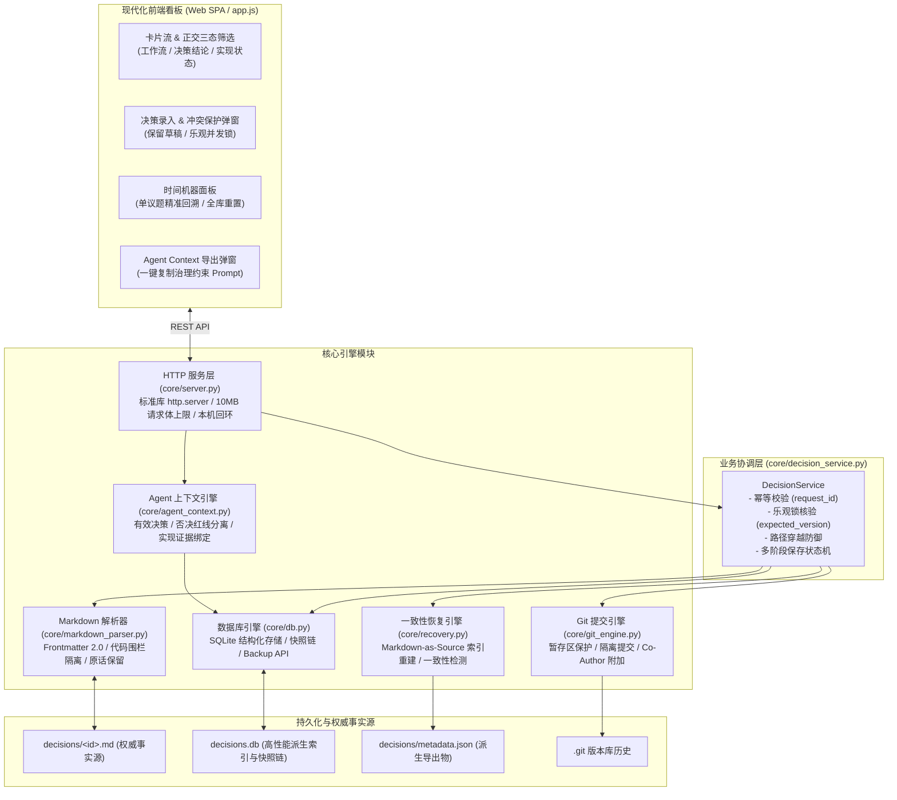

# Agent Decisions Dashboard ⚖️

> **通用 AI Agent 结对编程架构决策台账与 Git 自动化治理看板**  
> *Human-Agent Collaborative Architecture Decision Ledger & Automated Governance Dashboard*

[](https://www.gnu.org/licenses/gpl-3.0)
[](https://python.org)

[](./tests/)

在人类与 AI 智能体（Agent）进行长程、复杂的工程研发与协同编码时，传统的大文档容易发生**“历史结论被冲刷覆盖”、“多轮答复无法精确定位追溯”、“AI 重复提出已被明确否决的旧提案”、“代码已拍板但无法区分实现与决策”**等痛点。

`agent-decisions-dashboard` 是面向个人与本机 Agent 协作的轻量决策台账：记录讨论原话、当前结论、实现状态和验证证据，并提供可追溯的版本历史。Python 标准库服务配合静态 HTML/JavaScript，无需前端构建或云服务。

它适合回答“为什么这样决定、哪些方案已否决、哪些要求尚未落实”。项目范围是本机记录与追溯，不含账号权限、多人远程协作、任务排期或自动执行 Agent。导出的上下文需要调用者主动读取；看板不能保证 Agent 遵守结论。

## 当前可用功能

| 使用环节 | 实际行为 |
|---|---|
| 新建 | 页面“新建议题”填写 ID、标题、可选所属对象和正文，创建为待决策、尚无结论、未开始 |
| 讨论与决策 | 追加多行原话和答复；可修改最近一轮，旧内容留在版本历史；支持“部分同意”，需说明同意范围；否决必须有原因 |
| 查看 | 工作流、结论、实现状态及业务对象筛选；搜索标题、摘要、否决原因和最新答复；单项或批量展开/收起当前筛选下的议题；刷新最新状态 |
| Markdown | 保留单次换行；支持表格、标题、列表、引用、代码围栏与安全链接；本地按需绘制 Mermaid 流程图 |
| 概览 | “已定结论”从当前已决策且未暂缓/替代的议题生成，明确标示否决；“待决策”对应 pending 议题 |
| 引用 | 复制带完整本机 URL 的议题链接；链接打开后定位并展开议题 |
| 外观 | 默认粉白配色；顶栏可选樱粉、蓝、紫、青绿或琥珀，独立切换深浅模式；当前浏览器记住选择，主按钮统一使用白字 |
| 追溯 | 单议题恢复、撤销创建、全库快照恢复；Git 提交状态独立反馈 |
| Agent 与维护 | AGENTS.md 与可选只读检查钩子、完整上下文导出、人工核验证据登记、一致性检查、索引重建、SQLite 在线备份 |

页面编辑器用于追加讨论、修改最近一轮和更新状态；更早轮次保持只读，可在新一轮追加更正。已有议题的标题、正文和分类修改使用保存 API 或编辑权威 Markdown 后核对并重建索引。直接修改文件不会自动覆盖索引；“刷新”会检查并提示不同步。页面保留编辑草稿，保存后刷新列表并使旧详情缓存失效，保持刚保存的议题展开并定位；如果状态变更后不再符合原筛选条件，会提示并清除筛选以显示该议题。

Markdown 是安全的有限格式渲染器，不支持原始 HTML、完整 CommonMark 或任意插件。议题链接可写 `[议题名](#topic-id)` 或 `[议题名](decisions/topic-id.md)`；外部链接仅支持 HTTP(S)。流程图使用 `mermaid` 代码围栏，例如 `flowchart LR` 开头的图。Mermaid 12.1.0 已随项目提供本地资源，仅在图表可见时加载，使用严格模式；不执行图表配置指令，不加载图表外部图片，语法错误时保留源码并显示原因。大型图表限制为 50,000 字符、500 条边。

离线初次打开显示明确标识的示例数据，不是已保存项目的离线副本。

---

## 🏛️ 系统架构与职责边界

业务入口、存储与页面之间的关系：



---

## 🛡️ 核心治理机制与安全契约

### 1. 权威文档、索引与历史
- **以 Markdown 文件为权威事实源**：每个 `decisions/<id>.md` 记录完整的机器元数据、论述正文与全部历史讨论轮次。
- **SQLite 保存当前索引与历史快照**：当前议题可由 Markdown 重建；历史快照、变更日志和请求回执不能仅靠 Markdown 还原。页面列表从索引统计轮次，不扫描所有 Markdown；历史列表使用轻量议题 ID 缓存，旧快照首次读取时补齐缓存，完整快照内容不变。导出、一致性检查和重建仍会读取文件，未承诺固定耗时。
- **派生导出物**：`metadata.json` 是摘要列表，不含完整正文与讨论，不能单独用于恢复项目。不要直接编辑它。
- 数据库为空时自动导入已有 Markdown；新项目默认空白，`examples/decisions/` 不会自动复制。也可显式运行 `python -m core.server --rebuild-index`。
- 损坏的 SQLite 文件可能使程序在初始化阶段中止，不能直接靠上述命令修复。先停止服务，备份整个数据目录，保留并移出损坏数据库及其附属文件，再用完好的 `decisions/*.md` 重建新索引；若要保留旧快照和请求回执，需要有效数据库备份。

### 2. Git 暂存区隔离保护 (P1-B)
- **严禁意外夹带用户代码**：自动提交前自动执行 `git diff --cached --name-only` 扫描暂存区。
- **受控隔离提交**：若发现暂存区包含非本次操作的文件，跳过 Git 提交并保留已保存的数据。提交使用字面路径限定台账文件，不运行 `reset` 或 `stash`；提交失败时本次台账文件可能仍在暂存区。
- `git_commit.enabled` 可关闭自动提交；未配置 Git 身份、仓库不可用或提交失败不等于决策保存失败，检查响应中的 `save_status`、`export_status`、`git_status`。协作署名 `co_author` 默认留空，按实际参与者填写。不会自动 push。

### 3. 清晰的回滚边界与单议题精准回溯 (P1-C)
- **单议题历史精准回退**：默认支持 `/api/topic/:id/restore`，从历史快照中仅提取指定议题的状态并恢复，完全不波及其他议题的正常演进，并以 `action_type="TOPIC_RESTORE"` 生成新的审计版本，原历史完整保留。
- **全库快照恢复**：`/api/rollback` 恢复全部议题并写回 Markdown；快照外的 Markdown 会归档，历史保留。它影响其他议题，优先使用单议题恢复。
- 快照是可写 SQLite 中的版本记录，不具备防篡改签名或不可变审计保证。恢复快照也不等于导入数据库备份文件。

### 4. 并发乐观锁与幂等性防重放 (P1-D)
- **版本乐观锁**：HTTP 保存或恢复已有议题，以及核验接口，必须携带读取时的 `expected_version`（或 `X-Expected-Version` 请求头）；缺失返回 `428 Precondition Required`，过期返回 `409 Conflict`。版本号必须为正整数，不能使用布尔值或小数。创建新议题使用 `/api/topic/create`；恢复已删除的议题时可省略版本号，一旦议题已被重新创建则要求提供版本。
- **全库恢复前提**：从 `/api/git/log` 读取 `current_revision`，在 `/api/rollback` 中将其作为 `expected_revision` 传回；自读取以来存在新快照则拒绝恢复。前端历史面板已自动携带该字段。
- **页内草稿保护**：冲突时保留草稿并要求核对合并；请求结果不确定时保留原请求以供重试。草稿仅存在当前标签页内存中，刷新或关闭页面会丢失，浏览器离开提示不能替代备份。
- **幂等性保障**：创建、保存、单议题恢复和核验支持 `X-Request-ID`。相同请求数据重试时重放原结果或续做未完成阶段；相同 ID 携带不同内容时明确报错。全库恢复、索引重建和备份没有相同的重试契约。
- 恢复请求绑定原版本、快照、作者和原因；恢复已删除议题时，重试仍保留最初省略的版本参数。升级前旧格式的恢复回执会报冲突，先核对当前状态与历史，不要换 ID 盲目重做。延迟的保存/恢复重试遇到后续台账版本时会跳过旧 Git 补偿（`skipped_superseded`），避免把后续内容提交在旧说明下。
- **核验入口统一**：HTTP 与 Agent 调用均经过 `DecisionService`。核验的数据库更新、审计快照和幂等回执使用同一事务；Markdown 缺失或与索引不一致时拒绝核验。文件/导出写入失败时补偿还原，元数据导出使用临时文件原子替换。

### 本机访问边界

- 服务只接受 `localhost` 或回环 IP 监听，配置文件、环境变量和 `--host` 均不能开启局域网/公网监听；IPv6 可用 `--host ::1`。
- 校验请求 Host、端口和浏览器 Origin；POST 仅接受 `application/json`，拒绝跨站请求、重复 Content-Length 与 Transfer-Encoding，连接读取超时为 10 秒。静态资源禁止目录列表与越出网页目录的符号链接。
- 旧脚本更新已有议题前先读取 `/api/topic/:id` 的 `version`，原样作为 `expected_version` 发送。重试时保留原版本号、请求 ID 和请求内容；遇到 `409` 应重新读取并人工核对，不能自动改用最新版本覆盖。
- 这些限制不提供本机用户之间的身份认证。仅运行一个服务实例访问同一数据目录；维护 CLI 不应与服务同时写入。SQLite 与 Markdown 仍非单一存储事务，进程强制退出或断电后的跨文件恢复需检查 `--check-consistency`，核对权威 Markdown 后使用 `--rebuild-index`。
- HTTP 连接可并发接收，浏览器预连接不会阻塞其他请求；同一数据库的业务读写仍用进程内共享锁串行处理，版本检查与写入位于同一锁内。重建、备份或 Git 操作期间页面请求可能等待。连接读取超时为 10 秒，每条 Git 命令超时为 30 秒；超时须核对实际提交记录。这些限制不是完整的流量控制机制。

### 5. 正交状态模型与否决红线约束 (P2-E)
将复杂的业务生命周期拆解为正交三维空间：
- **工作流状态 (`workflow_state`)**：`pending`（待决策）| `discussing`（待讨论）| `decided`（已决策）
- **决策结论 (`decision_outcome`)**：空字符串（尚无结论）| `accepted`（已采纳）| `rejected`（明确否决）| `deferred`（推迟）| `superseded`（已被替代）
- **实现状态 (`implementation_state`)**：`not_started`（未开始）| `in_progress`（进行中）| `implemented`（已实现）| `verified`（已核验）
- **❌ 明确否决方案红线**：被否决方案同样是重要资产。系统强制保存否决原因与重新讨论前提，并在卡片与 Agent Prompt 中重点标红，防止 Agent 反复重提被否决的设计。
- **实现证据登记**：通过 `/api/topic/:id/verify` 记录提交引用、核验人及测试说明；服务不会验证提交是否存在，也不会执行测试。`verified` 是调用者声明的状态。一个提交引用本身不代表已实现。

### 6. 面向 Agent 的治理上下文导出 (P2-F)
- 提供 `/api/agent/context?module=...&format=markdown` 接口。
- 按 `module` 匹配 section/object/function，按 `path` 匹配正文或 section 子串，也可按 `topic_id` 查询；不自动分析代码依赖。
- 导出保留匹配议题的完整正文和讨论记录，并区分**有效决策**、**明确否决**与**待落实/核验**；暂缓和被替代议题不列为有效要求。较大的台账建议按议题或模块查询，网页默认导出全部。

### 7. Frontmatter 2.0 规范与代码围栏容错 (P2-G)
- 采用 `schema_version: "2.0"` Frontmatter，支持本项目字段、JSON 转义字符串和有限块标量，不是通用 YAML 解析器。
- 正文标题和闭合代码围栏内的模板示例会保留。若正文/原话在围栏外使用本项目的历史标题、轮次标题、用户/团队字段标头，或留下未闭合围栏，保存前的往返检查可能拒绝写入；按提示闭合围栏或把模板示例放进闭合围栏，防止静默丢内容。
- CRLF 在解析时归一化为 LF，字段两端空白会裁剪；保留语义内容，不保证字节级无损。

---

## 🚀 快速上手 (Quick Start)

### 1. 运行环境要求
- Python 3.9 及以上
- Git（仅自动提交功能需要；使用前配置仓库与提交身份）
- **Python 服务仅使用标准库**；浏览器图表库已随项目打包，无需 npm 安装或运行时访问 CDN。Mermaid 的版本、完整性与 MIT 许可见 [`web/vendor/`](./web/vendor/)。

### 2. 启动服务
- **Windows 用户**：双击运行 [`start_dashboard.bat`](./start_dashboard.bat)
- **Linux / macOS 用户**：
  ```bash
  chmod +x start_dashboard.sh
  ./start_dashboard.sh
  ```
- **命令行启动**：
  ```bash
  python -m core.server --port 8765
  ```

访问看板：**`http://127.0.0.1:8765`**。

以上命令在仓库根目录运行。首次启动点击“新建议题”，填写 ID 和标题后创建，展开卡片查看正文，再点击“确定决策”追加原话和团队答复。ID 只允许 1–128 位英文字母、数字、下划线和连字符；不能使用 Windows 设备名，也不能与已有 ID 仅大小写不同。

### 配置与数据位置

默认读取当前工作目录的 [`dashboard.config.json`](./dashboard.config.json)，缺省文件不存在时使用内置默认值。显式传入 `--config /path/to/dashboard.config.json` 时，相对数据路径与 Git 仓库根目录以该配置所在目录为准；配置缺失或格式错误会停止运行，防止误用另一项目的默认目录。

| 设置 | 缺省值 / 说明 |
|---|---|
| `decisions_dir` | `decisions`，权威议题文件 |
| `database_path` | `decisions.db`，索引、历史与请求回执 |
| `metadata_json_path` | `decisions/metadata.json`，摘要导出 |
| `git_commit.enabled` | `true`；设为 `false` 可只保存本地台账 |
| `host` / `port` | `127.0.0.1` / `8765`；可用 `AGENT_DASHBOARD_HOST`、`AGENT_DASHBOARD_PORT` 覆盖，命令行优先 |
| `categories` | 页面业务对象与功能分类配置 |

示例：`python -m core.server --config "D:/MyProject/dashboard.config.json" --no-browser`。无需复制服务源码到数据项目。`doc_data_json_path` 是保留的旧配置项，当前服务不使用它作为保存或导入入口。

### 3. CLI 维护工具命令
```bash
# 检查 Markdown 文件、SQLite 索引与 metadata.json 的一致性
python -m core.server --check-consistency

# 以 decisions/*.md 为权威事实源全量重建数据库索引
python -m core.server --rebuild-index

# 按模块导出供 Agent 注入的 Prompt Markdown 治理约束
python -m core.server --export-agent-context "核心架构"
```

一致性检查不通过、重建失败或只成功导入部分文件时退出码为非零；查看输出中的错误文件清单。重建会更新成功解析的议题并移除缺失文件的索引，运行前先核对文件与备份。部分成功不代表所有数据均已恢复。

### 4. Agent 入口与可选钩子

从 [AGENTS.md](./AGENTS.md) 开始，完整操作与宿主接入见 [Agent 操作指南](./docs/agent-workflow.md)。服务启动后，从仓库根目录执行：

```sh
python -m core.agent_hooks --config /path/to/dashboard.config.json before-task --topic adr-storage
python -m core.agent_hooks --config /path/to/dashboard.config.json after-write --topic adr-storage --receipt /path/to/receipt.json
```

任务前核对目标项目与一致性，再读取结论；写入后核对原始成功回执和当前版本。失败退出码为 2，不会把离线、错项目或过期回执当成空看板。钩子只读、可手动执行，不自动安装宿主钩子、不修改全局配置，也不证明实现或测试通过。

---

## 🔌 RESTful API 规范

| 接口路径 | 方法 | 说明 |
|---|---|---|
| `/api/config` | `GET` | 获取当前看板项目配置 |
| `/api/status` | `GET` | 获取服务运行状态、HEAD Hash 与存储一致性报告 |
| `/api/topics` | `GET` | 元数据、当前已定/待决策概览与变更记录 |
| `/api/topic/:id` | `GET` | **核心第二阶段**：按需异步读取解析单个议题 Markdown 正文与历史轮次 |
| `/api/topic/:id/save` | `POST` | 版本核验 -> 写 Markdown -> 更新索引与快照 -> 导出 JSON -> 尝试 Git 提交；这些阶段不是跨文件原子事务 |
| `/api/topic/create` | `POST` | 安全创建全新议题（校验 ID 防路径穿越） |
| `/api/topic/:id/restore` | `POST` | **单议题针对性回溯**：从指定快照恢复该议题，不影响其他议题 |
| `/api/topic/:id/verify` | `POST` | **实现证据核验绑定**：关联代码实现 Commit Hash、核验人与测试说明 |
| `/api/agent/context` | `GET` | 面向 Agent 导出只读决策与否决红线约束 (`?format=markdown|json`) |
| `/api/recovery/check` | `GET` | 检查三态存储一致性报告 |
| `/api/recovery/rebuild` | `POST` | 从 Markdown 文件全量重建 SQLite 索引 |
| `/api/backup` | `POST` | SQLite 一致性在线备份至 `backups/`，响应返回路径；不包含 Markdown，也没有备份文件导入接口 |
| `/api/rollback` | `POST` | 全库快照重置（同步写回 Markdown 与数据库） |
| `/api/git/log` | `GET` | 查询 Git 提交记录与 Revision 快照链 |

所有 POST 使用 `Content-Type: application/json`。以下示例使用标准库创建议题，再读取版本追加意见（服务须已启动，示例 ID 必须尚未存在）：

```python
import json
import uuid
from urllib.request import Request, urlopen

base = "http://127.0.0.1:8765"

def post(path, payload, request_id):
    req = Request(base + path, json.dumps(payload).encode("utf-8"),
                  {"Content-Type": "application/json", "X-Request-ID": request_id})
    with urlopen(req) as response:
        return json.load(response)

created = post("/api/topic/create", {
    "id": "adr-storage", "title": "存储选择", "workflow_state": "pending",
    "content_override": "记录待讨论的问题与依据。"
}, str(uuid.uuid4()))
with urlopen(base + "/api/topic/adr-storage") as response:
    topic = json.load(response)
request_id = str(uuid.uuid4())
payload = {"expected_version": topic["version"], "new_user_opinion": "先保留本地文件。"}
saved = post("/api/topic/adr-storage/save", payload, request_id)
```

省略已有议题的字段会保留原值；`content_override` 修改正文。网络异常时用相同 `payload` 和 `request_id` 重试；不要重新生成 ID 或盲目替换版本号。`409` 后读取最新内容并核对，`428` 表示缺少版本前提。直接调用 Python `DecisionService` 的版本参数仍可选，脚本应主动携带读取版本。

修改最近一轮时向同一保存接口传 `edit_latest_round: true`，必须带 `expected_version`，并用 `new_user_opinion` / `new_agent_reply` 指定要改的字段；省略的另一方回复保留，空字符串表示清空。修改生成新版本和快照，不增加讨论轮数，旧回复可在历史中恢复。并发新增轮次或同版本文件漂移会阻止覆盖；页面对新轮次冲突仅允许保留草稿后改为追加更正。

`decision_outcome: "partially_accepted"` 表示部分同意；首次切换时须在 `new_user_opinion` 说明范围。概览和筛选单独标示，Agent 上下文保留全部原话并明确其余内容尚未获同意，不把整项提案列为已完全采纳。

---

## 📄 单议题 Markdown 格式标准 (`schema_version: "2.0"`)

位于 `decisions/<id>.md` 的议题文件结构：

````markdown
---
schema_version: "2.0"
id: "adr-001-architecture-style"
title: "轻量微内核与单一可执行文件架构"
version: 2
section: "核心架构"
object: "通用系统"
function: "核心规范"
priority: "高"
workflow_state: "decided"
decision_status: "已定"
sources: ""
decision_outcome: "accepted"
rejection_reason: ""
superseded_by: ""
implementation_state: "implemented"
impl_commit: "de371b8"
impl_verifier: "Antigravity-AI (单元测试 19/19 通过)"
---

# 轻量微内核与单一可执行文件架构

> **锚点 ID**：`adr-001-architecture-style` | **所属对象**：`通用系统` | **业务功能**：`核心规范`
> **生命周期**：`🟢 已决策` | **决策状态**：`已定` | **实现现状**：`implemented` | **优先级**：`高`

## 核心论述与现实依据

系统定位为人机协同决策治理台账，必须保证本地优先、极简启动与无外部依赖。

## 历史讨论与决策记录

### 第 1 轮定案与要求 (2026-10-05 10:00)
- **变更说明**：初始化架构决策
- **💡 用户意见（最新原话）**：
采用标准库开发，不引入外部第三方框架，保证单执行脚本直接启动。
- **🤖 团队答复（落实说明）**：
已基于 Python 标准库 http.server 与 sqlite3 构建核心微内核。
````

---

## 🧪 自动化测试验证

项目使用标准库单元与回归测试，覆盖保存、恢复、并发冲突与 HTTP 边界等场景。测试通过不代表所有平台、断电或恶意本机进程场景均已验证：

```bash
python -m unittest discover tests
```

- `test_git_engine.py`：暂存区隔离保护、存在其他已暂存文件时拒绝误提交、锁定检测
- `test_db_and_concurrency.py`：乐观并发版本锁（409 Conflict）、幂等键去重重放、单议题回退、SQLite 在线备份
- `test_markdown_parser.py`：Frontmatter 2.0 往返序列化、代码围栏内假轮次隔离、多行原话保留、CRLF 归一化
- `test_decision_service.py`：端到端状态机协调、非法 ID 与路径穿越强拦截、多阶段状态输出
- `test_agent_and_recovery.py`：以 Markdown 为事实源重建索引、有效决策与否决红线分离、代码实现核验证据绑定
- `test_security_boundaries.py`：真实 HTTP 入口的 Host/Origin、版本前提、核验失败补偿和幂等性、全库恢复冲突、慢请求、静态目录边界；符号链接用例在主机不允许创建链接时跳过
- `test_product_contracts.py`：部分字段更新保留原值、正文与讨论往返校验、跨平台 ID 冲突、完整上下文、概览、配置目录和失败退出码
- `test_final_audit.py`：旧记录兼容、快照恢复预检、失败重试、延迟 Git 补偿、历史缓存、空连接与真实 HTTP 并发写入
- `test_agent_hooks.py`：钩子目标校验、完整上下文、写回执、离线/漂移/过期结果和 CLI 退出码

Git 提交使用字面路径匹配与 NUL 分隔的暂存区列表，避免特殊目录名/中文路径导致误暂存；空目标列表不执行提交。相关规则见 [Git pathspec 文档](https://git-scm.com/docs/gitglossary.html#def_pathspec)，静态链接边界见 [Python HTTP 服务安全说明](https://docs.python.org/3/library/http.server.html#security-considerations)。

---

## 📜 开源许可证

本项目采用 **[GNU General Public License v3.0 (GPLv3)](./LICENSE)** 许可证开源。  
欢迎在各类人机协同、自主 Agent 治理与软件工程研发项目中引用与二次开发。
