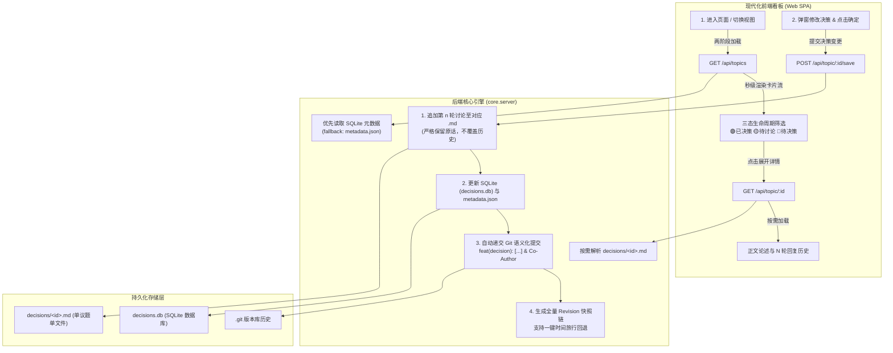

# Agent Decisions Dashboard ⚖️

> **通用 AI Agent 结对编程架构决策台账与 Git 自动化治理看板**  
> *Human-Agent Collaborative Architecture Decision Ledger & Automated Governance Dashboard*

[](https://www.gnu.org/licenses/gpl-3.0)
[](https://python.org)
[-orange.svg)]()

在人类与 AI 智能体（Agent）进行长程、复杂的工程研发与协同编码时，传统的大文档容易发生**“历史结论被冲刷覆盖”、“多轮答复无法精确定位追溯”、“AI 重复提出已被否决的旧提案”**等痛点。

`agent-decisions-dashboard` 是一套轻量、开箱即用且高度解耦的架构决策与实施台账系统。它将架构决策记录（ADR）、多轮人机辩论、三态生命周期流转、SQLite 元数据索引以及 Git 自动提交融为一体，为 AI 辅助编程提供严密的治理红线与审计基线。

---

## 🏛️ 五大核心设计构型



1. **单议题单 Markdown 文件 (`decisions/<id>.md`)**：
   每个议题独立成文，包含元数据标头、核心技术论述以及历史各轮次讨论，彻底杜绝单一大文档合并冲突。
2. **N 轮讨论完整保留，永不覆盖历史**：
   每次做出新决策，系统自动以 `### 第 N 轮定案与要求 (YYYY-MM-DD HH:MM)` 追加到对应 Markdown 末尾，永久保留双方原话与推演依据。
3. **统一状态与元数据管理 (SQLite + JSON)**：
   议题的生命周期三态、实现状态、优先级与最新原话均集中在 SQLite (`decisions.db`) 与 `metadata.json` 中统一索引。
4. **确定决策即自动递交 Git Commit**：
   在看板点击“确定决策”时，系统自动执行 `git add` 并生成语义化提交：
   `feat(decision): [🟢 已决策] <议题标题> - <修改说明>\n\n用户指示：...\n\nCo-authored-by: ...`
5. **不可篡改 Revision 快照链与一键时间旅行**：
   每次变更同时在 SQLite `revisions` 表记录全量快照，支持随时在看板中查看版本差异并一键回滚。

---

## 🚀 快速上手 (Quick Start)

### 1. 运行环境要求
- Python 3.9 及以上
- Git 2.0 及以上
- **零外部第三方 Python 依赖**（完全基于 Python 标准库 `http.server`、`sqlite3` 构建）

### 2. 一键启动
- **Windows 用户**：双击运行根目录下的 [`start_dashboard.bat`](./start_dashboard.bat)
- **Linux / macOS 用户**：
  ```bash
  chmod +x start_dashboard.sh
  ./start_dashboard.sh
  ```
- **命令行启动**：
  ```bash
  python -m core.server --port 8765
  ```

服务启动后，默认自动打开浏览器访问：**`http://127.0.0.1:8765`**。

---

## ⚙️ 配置文件说明 (`dashboard.config.json`)

系统支持开箱即用，您也可以通过修改根目录下的 `dashboard.config.json` 完全定制界面与业务维度：

```json
{
  "project_name": "My Project Decisions",
  "project_subtitle": "架构决策与实施台账",
  "brand_logo": "PD",
  "brand_icon": "⚖️",
  "host": "127.0.0.1",
  "port": 8765,
  "decisions_dir": "decisions",
  "database_path": "decisions.db",
  "metadata_json_path": "decisions/metadata.json",
  "git_commit": {
    "enabled": true,
    "commit_prefix": "feat(decision)",
    "co_author": "Antigravity <antigravity@google.com>",
    "include_user_opinion": true,
    "include_agent_reply": true
  },
  "categories": {
    "objects": ["核心架构", "前端界面", "后端服务", "存储层", "DevOps"],
    "functions": ["设计规范", "API协议", "安全策略", "性能调优", "运维部署"]
  },
  "lifecycle_states": [
    { "id": "decided", "name": "已决策", "badge": "🟢 已决策", "badge_class": "badge-decided" },
    { "id": "discussing", "name": "待讨论", "badge": "🟡 待讨论", "badge_class": "badge-discussing" },
    { "id": "pending", "name": "待决策", "badge": "🔴 待决策", "badge_class": "badge-pending" }
  ]
}
```

---

## 🔌 REST API 规范

服务端内置了开箱即用的 RESTful API 接口，便于集成自动化脚本或 CI/CD 流水线：

| 接口 | 方法 | 说明 |
|---|---|---|
| `/api/config` | `GET` | 获取当前看板的完整配置信息 |
| `/api/status` | `GET` | 获取服务运行状态、数据库名称与当前 Git HEAD 提交 Hash |
| `/api/topics` | `GET` | **核心第一阶段接口**：快速获取所有议题的元数据列表（毫秒级响应） |
| `/api/topic/:id` | `GET` | **核心第二阶段接口**：按需异步读取解析单个议题的 Markdown 与完整历史轮次 |
| `/api/topic/:id/save` | `POST` | 追加新一轮讨论、更新 SQLite、刷新 metadata 并自动触发 Git Commit |
| `/api/topic/create` | `POST` | 创建全新议题并自动入库 |
| `/api/git/log` | `GET` | 获取最近 Git 提交记录与 SQLite Revision 快照列表 |
| `/api/rollback` | `POST` | 根据 Revision ID 将数据库全量回滚至历史指定版本并生成审计记录 |

---

## 📄 单议题 Markdown 文件格式标准

每个位于 `decisions/<id>.md` 的文件结构如下：

````markdown
# 议题标题：系统架构选型

> **锚点 ID**：`topic-id` | **所属对象**：`核心架构` | **业务功能**：`设计规范`
> **生命周期**：`🟢 已决策` | **决策状态**：`已定案` | **实现现状**：`已完成` | **优先级**：`最高`

## 核心论述与现实依据

此处撰写该议题的产生背景、技术选型分析与长期架构依据。

## 历史讨论与决策记录

### 第 1 轮讨论与定案 (2026-10-05 10:00)
- **💡 用户意见（最新原话）**：这是用户的初始指令或决策意见。
- **🤖 团队答复（落实说明）**：这是技术团队或 Agent 给出的落实方案。

### 第 2 轮定案与要求 (2026-10-05 14:00)
- **变更说明**：追加更严格的安全约束与测试用例
- **💡 用户意见（最新原话）**：要求增加异常容灾兜底。
- **🤖 团队答复（落实说明）**：已增加本地降级机制与超时保护。
````

---

## 📜 开源许可证

本项目采用 **[GNU General Public License v3.0 (GPLv3)](./LICENSE)** 许可证开源。
欢迎在各类人类与 Agent 协同研发的软件项目中引用与二次开发。
