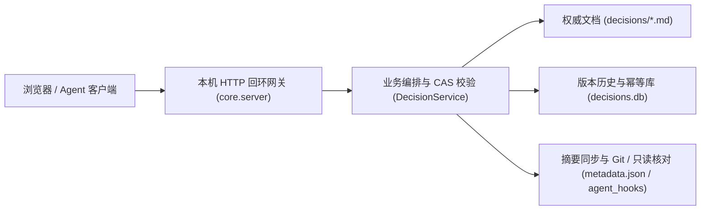

<p align="center">
  
</p>

<h1 align="center">Agent Decisions Dashboard</h1>

<p align="center">
  <a href="./LICENSE"></a>
  <a href="./pyproject.toml"></a>
  <a href="./pyproject.toml"></a>
  <a href="./tests/"></a>
</p>

<p align="center">
  <strong>简体中文</strong> | <a href="README.en.md">English</a>
</p>

<p align="center">
  <a href="https://agent-decisions-dashboard.cbnv.me/">在线文档</a> · <a href="docs-site/index.md">文档站源码</a> · <a href="repo-docs/README.md">中文源码指南</a>
</p>

面向个人与本机 AI 编程工具协作的轻量决策台账：后端仅依赖 Python 3.9+ 标准库与 SQLite，前端采用零构建静态资源与离线打包库；仅用于本机回环记录、批注审阅与历史追溯。

## 能做到什么程度与明确不能做什么

| 维度 | ✅ 能做到什么程度（已实现） | ⛔ 明确不能做什么（非目标与限制） |
| --- | --- | --- |
| 运行与部署 | 纯 Python 3.9+ 标准库 + SQLite，零 CDN 零构建运行；支持 `--config` 挂载外部项目目录 | 严格限制回环主机（拒绝 `0.0.0.0`），单进程锁，不支持多人并发或远程鉴权 |
| 记录与恢复 | `schema_version: "2.0"` Markdown + SQLite 历史快照、CAS 锁、`request_id` 幂等、在线备份与隔离 Git 提交 | 仅靠 `metadata.json` 不能还原历史；服务端不替代业务仓库构建或合并分支 |
| Agent 接线 | 按 `topic_scope` 导出五桶上下文、只读 CLI 钩子与 `agent-question` 单选卡 | `accepted` / `verified` 仅存台账文本，绝不自动跑测试或授予 Shell 执行权 |

## 核心能力与数据流

- **三轴正交状态治理**：将进展（`workflow_state`）、结论（`decision_outcome`，支持 `partially_accepted` 局部同意）与实现进度（`implementation_state`）完全拆分，保留旧协议只读兼容。
- **双栏专注工作台**：支持新建、追加讨论、仅修改最近一轮（`edit_latest_round`）、安全归档删除（`delete_topic`）以及基于 `agent-question` 围栏的单选批注卡片。
- **可追溯写流水线**：基于 `schema_version: "2.0"` Markdown 权威文件与 SQLite 乐观锁（`expected_version`）、ABA 防护序列及 `request_id` 幂等缓存落盘，可选路径隔离 Git 提交。
- **可控 Agent 接线**：提供按 `topic_scope` 过滤的五桶上下文接口与只读命令行钩子（`before-task` / `after-write`），绝不自动修改台账或触发构建测试。



- **单机与安全边界**：仅绑定本机回环地址，写入校验 `Host`、`Origin` 与 `Sec-Fetch-Site`，限制请求体 10 MiB（10 秒读取超时），并对议题 ID 拦截路径穿越与 Windows 保留文件名。

## 快速上手

需 Python 3.9 及以上版本；无需安装 Node.js、pnpm 或外网 CDN 即可运行工作台（`tests/*.test.js` 使用 Node，`docs-site/` 构建使用 pnpm）：

```sh
git clone https://github.com/CyberNova2333/agent-decisions-dashboard.git
cd agent-decisions-dashboard
./start_dashboard.sh --port 8765
# 或直接调用模块：python3 -m core.server --port 8765
# 如需在独立端口无浏览器启动：python3 -m core.server --port 8765 --no-browser
```

启动后访问 `http://127.0.0.1:8765/dashboard.html`；运行完整测试集可用 `python3 -m unittest discover tests && node --test tests/*.test.js`。

| 常见运行模式 / 平台 | 启动或操作命令 | 详细文档入口 |
|---|---|---|
| Windows 本机启动 | 双击或执行 `start_dashboard.bat`（支持透传 CLI 参数） | [起步与配置部署](docs-site/docs/index.md) |
| 挂载外部项目目录 | `python3 -m core.server --config /path/to/dashboard.config.json --no-browser` | [配置矩阵与路径规则](docs-site/docs/index.md#配置矩阵与优先级) |
| 离线一致性诊断与重建 | `python3 -m core.server --check-consistency` / `--rebuild-index` | [排错与维护模式](docs-site/docs/index.md#部署与运行排错-faq) |
| 按模块导出上下文 | `python3 -m core.server --export-agent-context 存储层` | [上下文导出与接口契约](docs-site/docs/contracts.md) |
| Agent 只读钩子核对 | `python3 -m core.agent_hooks --config dashboard.config.json before-task` | [接口与扩展契约](docs-site/docs/contracts.md) |

## 选型与边界 FAQ

**Q：运行看板需要安装 Node.js、npm 或访问外网吗？**

不需要。后端只使用 Python 标准库与 SQLite，前端 Mermaid 12.1.0、Anime.js 4.5.0 与 IBM Plex Sans 字体全部离线保存在 `web/vendor/`；Node 仅用于跑前端测试，pnpm 仅用于构建文档站。

**Q：支持多人远程同时连接或同一数据目录多进程启动吗？**

不支持。HTTP 服务严格限制在本机回环地址（`127.0.0.1` / `localhost`）且采用进程内线程锁，同一 `database_path` 在同一时刻只能由单个服务进程管理。

**Q：开启自动 Git 提交会误把工程里尚未提交的其他改动一起提交吗？**

不会。`core.git_engine` 在提交前会检查当前暂存区是否存在无关文件，发现即安全跳过提交并如实返回 `git_status: "skipped_unrelated_staged"`，台账落盘仍保持成功。

**Q：把议题标为 `accepted`、`verified` 或勾选 `agent-question` 会自动改代码或跑测试吗？**

不会。所有状态字段与单选回复都只是台账数据，`core.agent_hooks` 也是严格只读命令，服务端不会代替调用者执行测试、运行脚本或授予执行权限。

**Q：仅有 `decisions/*.md` 或 `metadata.json` 能否完整还原全部台账？**

Markdown 保存当前最新正文，可用 `--rebuild-index` 重建 `topics` 索引；但 `metadata.json` 只是只读摘要，历史版本快照 `revisions` 与请求幂等表仅存于 `decisions.db`。

## 阅读路径

| 你的目标 | 文档站入口 | 源码指南入口 |
|---|---|---|
| 安装启动、接入外部项目与配置排错 | [起步与配置部署](docs-site/docs/index.md) | [源码指南入口与运行说明](repo-docs/README.md) |
| 逐一查询端点、CLI 参数与调用示例 | [API 与组件参考](docs-site/api-reference/index.md) | [接口与扩展契约](docs-site/docs/contracts.md) |
| 对接 HTTP API、三轴契约与只读钩子 | [接口与扩展契约](docs-site/docs/contracts.md) | [三轴状态模型与 Agent 工作流](repo-docs/modules/states-and-agent-workflow.md) |
| 跟踪一次完整写入与幂等/恢复原理 | [原理与源码导览](docs-site/docs/architecture.md) | [一次讨论怎样保存成可追溯记录](repo-docs/walkthroughs/one-real-run.md) |
| 定位核心模块代码、归档机制与测试 | [代码地图与决策迁移](docs-site/docs/architecture.md#源码目录与模块地图) | [代码地图](repo-docs/code-map.md) · [保存与恢复模块](repo-docs/modules/save-idempotency-and-recovery.md) |
| 审查源码核对证据、术语与同步基线 | [设计规范 (`DESIGN.md`)](DESIGN.md) · [贡献与安全](CONTRIBUTING.md) | [核心术语表](repo-docs/glossary.md) · [源码证据审计](repo-docs/references/source-evidence.md) |

## 许可证与第三方致谢

本项目代码依据 [GNU AGPLv3 (`AGPL-3.0-only`)](./LICENSE) 许可开源。随仓库离线打包的前端资产保留各自原始许可声明，包括 `web/vendor/` 下的 Mermaid 12.1.0（[MIT](./web/vendor/mermaid-LICENSE)）、Anime.js 4.5.0（[MIT](./web/vendor/ANIMEJS-LICENSE.md)）与 IBM Plex Sans 字体（[OFL](./web/vendor/IBM-Plex-Sans-LICENSE.txt)）。

- **附加条款与资产规则**：本项目依据 GNU AGPLv3 第 7 条适用 [`ADDITIONAL_TERMS.zh-CN.md`](ADDITIONAL_TERMS.zh-CN.md)（英文参考译文：[`ADDITIONAL_TERMS.en.md`](ADDITIONAL_TERMS.en.md)，以简体中文完整版正文为准），对来源陈述、修改标识、禁止冒充、扩展模块有条件附加许可及项目标识边界作出补充说明；独立美术、字体与图标许可清单见 [`ASSET_LICENSES.md`](ASSET_LICENSES.md)。第 9.5–9.6 款的附加许可豁免仅对已取得相应版权持有人有效授权的适用材料生效，未取得该等授权的第三方或上游材料仍受其原有有效许可约束。
